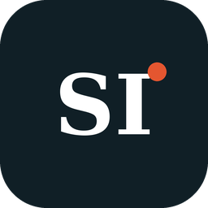

<div align="center">
  
  <h1>ScribeInk</h1>
  <p>An on-device clinical scribe for macOS</p>

  [](https://www.gnu.org/licenses/gpl-3.0)
  
</div>

---

ScribeInk is Chartside's on-device clinical scribe for macOS. It turns a clinician's dictation or
visit recording into text, and (as the roadmap lands) into a draft note for the clinician to
review. ScribeInk is designed so that audio, transcripts, notes and prompts stay on the device:
transcription and note generation run locally, and cloud providers are switched off. This is
still being verified on a Mac (see the on-device checklist below).

Known limitation: point custom and Ollama endpoints only at servers you control, because
redirects from them are followed. See "Known limitations" in
`docs/superpowers/specs/2026-11-06-on-device-only-design.md`.

ScribeInk is open source under the GNU General Public License v3.0. Chartside's paid tiers
(support, templates, compliance, EHR integrations) live outside this repository.

## Attribution

ScribeInk is based on VoiceInk by Prakash Joshi Pax, licensed under GPL v3. Upstream project:
[github.com/Beingpax/VoiceInk](https://github.com/Beingpax/VoiceInk). Upstream copyright
notices are kept in the source files.

## Installs next to VoiceInk

ScribeInk is a parallel install: it uses its own bundle identifier (`com.chartside.ScribeInk`),
settings, history, models and Keychain items, so it can run next to an existing VoiceInk
without sharing data. The development build (`ScribeInk Dev`) is separate again. Internal
Xcode target, file and Swift type names stay `VoiceInk*` to keep upstream merges workable.

## Build

Requires macOS 15.0 or later and Xcode. From the repository root:

```shell
make local
```

This produces `~/Downloads/ScribeInk.app`. See [BUILDING.md](BUILDING.md) for details,
including signing. Signed distribution builds need Chartside's Apple developer team.

## Requirements

- macOS 15.0 or later

## Documentation

- [CLAUDE.md](CLAUDE.md): project rules, identity, roadmap
- [DESIGN.md](DESIGN.md): colour, type and component rules
- [BUILDING.md](BUILDING.md): building from source
- [On-device checklist](docs/qa/on-device-checklist.md): QA for the no-network rules
- [Identity checklist](docs/qa/scribeink-identity-checklist.md): QA for the rename and attribution
- [Contributing Guidelines](CONTRIBUTING.md) and [Code of Conduct](CODE_OF_CONDUCT.md)

## Support

Open an issue at [github.com/chartside/scribeink](https://github.com/chartside/scribeink).
Never include patient information in an issue; use synthetic data only.

## License

GNU General Public License v3.0. See the [LICENSE](LICENSE) file.

## Acknowledgments

### Core Technology
- [whisper.cpp](https://github.com/ggerganov/whisper.cpp) - High-performance inference of OpenAI's Whisper model
- [FluidAudio](https://github.com/FluidInference/FluidAudio) - Used for Parakeet model implementation
- [TranscribeCpp for Swift](https://github.com/Beingpax/Transcribe-cpp-swift) - SwiftPM distribution of [transcribe.cpp](https://github.com/handy-computer/transcribe.cpp), used for local GGUF transcription models
- [SenseVoice Small](https://huggingface.co/FunAudioLLM/SenseVoiceSmall) by FunAudioLLM / Alibaba - Multilingual model available under the [FunASR Model Open Source License Agreement](https://github.com/modelscope/FunASR/blob/main/MODEL_LICENSE)

### Essential Dependencies
- [Sparkle](https://github.com/sparkle-project/Sparkle) - Update framework (switched off in ScribeInk until Chartside publishes its own updates)
- [KeyboardShortcuts](https://github.com/sindresorhus/KeyboardShortcuts) - User-customizable keyboard shortcuts
- [LaunchAtLogin](https://github.com/sindresorhus/LaunchAtLogin) - Launch at login functionality
- [MediaRemoteAdapter](https://github.com/ejbills/mediaremote-adapter) - Media playback control during recording
- [Zip](https://github.com/marmelroy/Zip) - File compression and decompression utilities
- [Swift Atomics](https://github.com/apple/swift-atomics) - Low-level atomic operations for thread-safe concurrent programming


---

Original VoiceInk by Prakash Joshi Pax.
